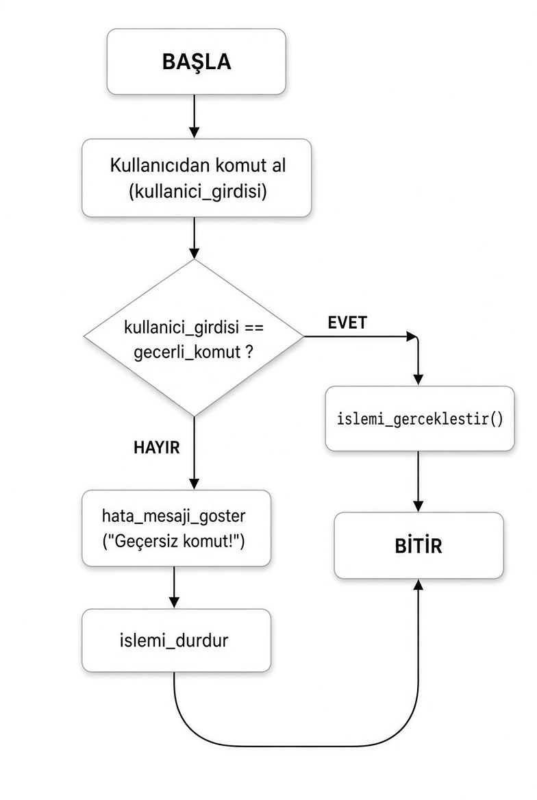

# kod_asistanim

Proje Yazarı: Ela Yıldızhan

## projenin adı
Kod-Asistan v0.1

## projenin amacı
Kullanıcılara günlük işlerinde (hesaplama, selamlama vb.) yardımcı olacak dijital asistan tasarlamak.

## projenin hedefleri
-proglamlama öğrenmek.
-kod yazma becerisi kazanmak.
-algoritma oluşturmayı öğrenmek.
-kodlama hatalarını farkedebilmek.

## projenin kapsamı
bu projede kullanıcıya yardımcı olan basit bir dijital asistan tasarladım.

**Kritik Eşik**
EĞER (kullanici_girdisi == geceeli_komut) islemi_gerceklestir();
DEĞİLSE 
 // Kritik eşik aşıldı. Yanlış veya boş. giriş yapıldı.
 hata_mesajı_göster "Geçersiz komut!" işlemi_durdur

## kaynakça
proglamlama temelleri ders kitabı 9. sınıf
Akış şeması görseli, Grok (xAI) yapay zeka modeli kullanılarak hazırlanmıştır. (01.11.2026)

